```{=html}
<style>
/* Base: make Quarto callouts behave like full cards */
.callout.fill-box {
  /* Unified background & border for the whole card */
  --box-bg: #eaf6ee;   /* default soft green if no class overrides */
  --edge-color: #1f6f43; /* default darker edge/title color */
  background: var(--box-bg);
  border: 1px solid var(--edge-color);
  border-radius: 8px;
  margin: 1rem 0;
  overflow: hidden; /* keeps rounded corners clean when title is darker */
}

/* Title bar: darker shade; full-width across top */
.callout.fill-box .callout-title {
  background: var(--edge-color);
  color: #fff;
  padding: 0.6rem 0.8rem;
  font-weight: 600;
  border-bottom: 1px solid var(--edge-color);
}

/* Body: same light color as the card, not a separate “stripe” */
.callout.fill-box .callout-body {
  background: transparent; /* let the parent set the background */
  padding: 0.9rem 1rem;
}


/* --- Specific palettes --- */
/* Green: "Why are we doing this?" */
.callout.why-box {
  --box-bg: #eaf6ee;    /* light green fill */
  --edge-color: #1f6f43;/* dark green edge/title */
}

/* Purple: "Your Task" */
.callout.task-box {
  --box-bg: #f3ecfb;    /* light purple fill */
  --edge-color: #7140a6;/* deep purple edge/title */
}

/* Yellow: "Objectives" */
.callout.objectives {
  --box-bg: #f2eee4;    /* light yellow fill */
  --edge-color: #CfAE70; /* deep yellow edge/title */
}

</style>
```

::: {.callout .fill-box .objectives}
# Introduction and Learning Objectives 

Now that we have identified the strategies and downloaded Amua on your
computer. You are ready to start build a decision tree for the research
question.

By the end of this session, participants will be able to:

1.  Build and structure a decision tree model in Amua to represent
    clinical decision problems.

2.  Define and parameterize key inputs (e.g., probabilities, outcomes,
    and costs) within the Amua software.

3.  Evaluate model outcomes for alternative clinical strategies.

4.  Add and compare multiple strategies (e.g., diagnostic testing
    options) in a single decision framework.
:::

::: {.callout .fill-box .why-box}
## Why are we doing this?

No variable is 100% accurate and therefore it is important to understand
how the model would change if a variable was not the entered value. A
One-Way Sensitivity Analysis (OWSA) allows us to understand which
parameters have the most impact by varying one at a time. The
Probabilistic Sensitivity Analysis (PSA) accounts for the fact that in
reality variables are not all linear. The PSA tells us how often our
decision would be made if variables were different in tandem.
:::

Before we get building, we recommend reviewing the sensitivity options
that are offered in Amua

<https://github.com/zward/Amua/wiki/Sensitivity-Analysis>

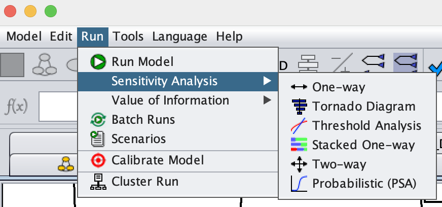

# Step 1: Complete the model

Congrats, you have already completed step 1 if you have worked through
the case study sequence.

If not, please download the following:

\`\`\`{r, echo=FALSE,
include=knitr::opts_knit\$get('rmarkdown.pandoc.to') == 'html'}
library(downloadthis) \## Link in Github repo download_link( link =
"https://geratcliff.github.io/vital-2026-Cebu/case-studies/cs_markov_diseaseX_DALYS_ANS.amua",
button_label = "Download Markov Amua File", button_type = "primary",
has_icon = TRUE, icon = "fa fa-save", self_contained = FALSE )

# Step 2: Identify the variance ranges

For every variable that you want to test, you need determine the range
of values that it should be tested on. Typically this is a confidence
interval for values from clinical trials. For other variables you can
use things like common ranges, expert opinions, and assumptions

Below are the ranges we will use:

| Variable        | Value | Range       |
|-----------------|-------|-------------|
| p_sick          | 0.03  | 0.01-0.07   |
| p_sicker        | 0.12  | 0.08-0.30   |
| p_diseasedeath  | 0.15  | 0.02-0.26   |
| sens            | 0.9   | 0.86-0.93   |
| prev            | 0.08  | 0.074-0.086 |
| hr_treated      | 0.5   | 0.1-0.7     |
| initial_age     | 50    | --          |
| c_treatment     | 30000 | 1000-500000 |
| c_pall          | 15000 | 5000-25000  |
| c_mild          | 1000  | 500-2000    |
| c_initialsicker | 50000 | 42000-66000 |
| u_healthy       | 1     | --          |
| u_sick          | 0.842 | 0.81-0.88   |
| u_sicker        | 0.645 | 0.60-0.70   |
| u_dead.         | 0     | --          |
| u_treatment     | 0.932 | 0.92-0.94   |

Note: We do not need to vary initial age, utility of healthy, or utility
of death

::: {.callout .fill-box .task-box}
## Your Task

Understand how each individual input impacts the model when the rest of
the inputs remain constant
:::

# Step 3: Run a OWSA

## A: Setup the Run

1.  Go to Run \> Sensitivity Analysis \> Tornado Diagram
    - We will be using a tornado diagram as it is the most common method
      for presenting OWSA results


2.  Add in all the Low and High values. This is the determined lower and
    upper bound for each value.
3.  Click Run
4.  Set the Outcome to "ICER (Cost/LY)"
5.  Highlight the strategy being compared to the base case. For this
    example that would be "Treat All".

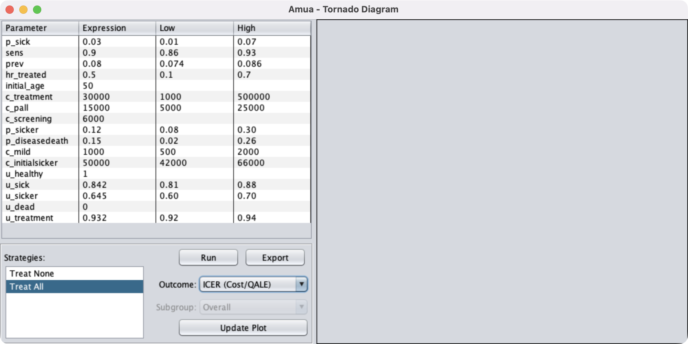

## B: Run The Analysis

1.  Click "Update Plot"

The plot should now display a bar for each variable with inputs
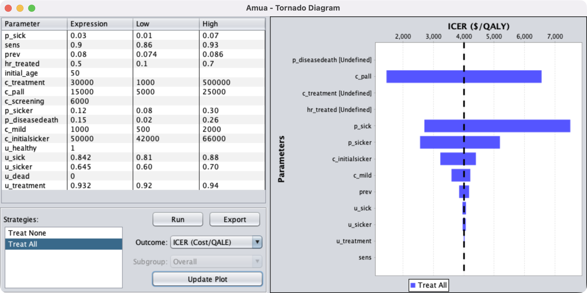

## C: Check The Plot

1.  Verify that the plot makes sense
    - Is the direction correct?
    - Are the most impactful variables what you would expect?

## D: Common Issues

- If your strategy is dominated or dominant, ICERs will not show. This
  would render the tornado useless.

  - However, in the benefits lecture we talked about the alternatives
    (NMB or NHB). You can get this by setting the analysis type to
    "Benefit-Cost Analysis (BCA)" in Model \> Properties \> Analysis

    - <https://github.com/zward/Amua/wiki/Model-Properties#analysis-type>

- You have more than two strategies.

  - A tornado diagram cannot provide clear information when more than
    two strategies are involved. We recommend using the Stacked One-Way
    sensitivity Analysis.

  - **Example:** 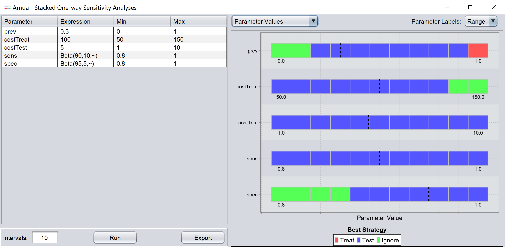

    ###### *image source: <https://github.com/zward/Amua/wiki/Sensitivity-Analysis#stacked-one-way>*

::: {.callout .fill-box .task-box}
## Your Task

Understand the values of parameters where the decision changes
:::

# Step 4: Threshold Analysis

## A: Change the analysis to NMB (net-monetary benefit)

1.  Go to Model \> Properties \> Analysis
2.  Change the **Analysis Type:** to `Benefit-Cost Analysis (BCA)`
3.  Make sure that you have a Cost, Benefit, and WTP

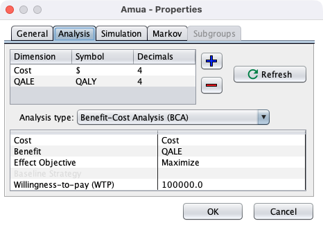

## A: Setup the Run

1.  Go to Run \> Sensitivity Analysis \> Threshold


2.  Add in all the Low and High value for the variable you want to test.
    Make sure that it is selected. (One variable is tested at a time)
3.  If you have more than two strategies, choose the two strategies that
    you want to compare
4.  Set the outcome to `NMB (QALE-Cost)`
5.  Intervals is set to `10`, increase this number to get more granular
    data.


## B: Run The Analysis

1.  Click "Run"

The plot shows the NMB of the strategies over the range of test values
for the input parameter. In addition the **Threshold:** value appears
above the **Run** button.

For `c_treatment` the threshold is `299586.4802`. In other words, when
treatment costs over \$299,586.48, Treat All is no longer cost-effective
compared to Treat None.

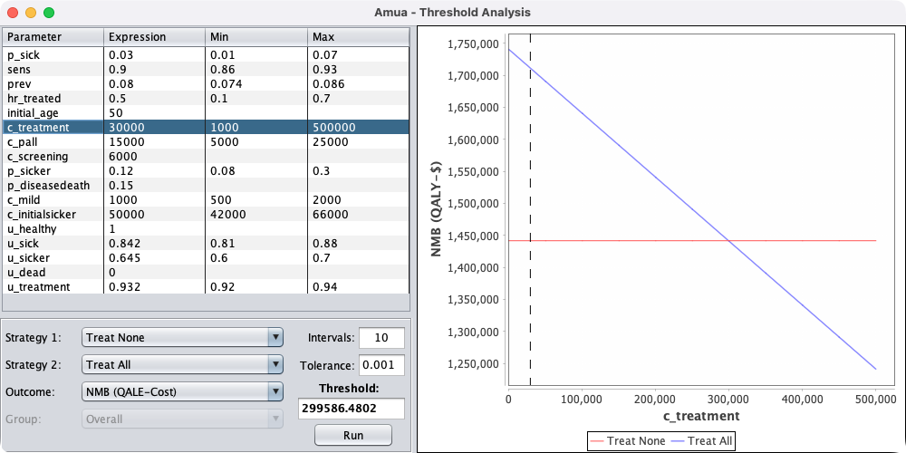

## C: Check The Plot

1.  Verify that the plot makes sense. For example, as cost of treatment
    is more expensive it is logical for the treat all strategy to be
    less effective.

## D: Common Issues

- If your strategy is dominated or dominant, ICERs will not show and
  therefore no graph will be created.

  - However, in the benefits lecture we talked about the alternatives
    (NMB or NHB). You can get this by setting the analysis type to
    "Benefit-Cost Analysis (BCA)" in Model \> Properties \> Analysis

    - <https://github.com/zward/Amua/wiki/Model-Properties#analysis-type>

::: {.callout .fill-box .task-box}
## Your Task

Compare two parameters to understand how the decision changes in
relation to each other
:::

# Step 5: Run a TWSA

## A: Setup the Run

1.  Go to Run \> Sensitivity Analysis \> Two-way


2.  Add in the Low and High values for the *two variables you want to
    compare*. This is the determine lower and upper bound for each
    value.
3.  Set Parameter 1 to `hr_treated`
4.  Set Parameter 2 to `c_treatment`
5.  Set Outcome to ICER (Cost/Effect)
6.  Set Cost-Effectiveness threshold to `100000`
7.  Intervals is set to `10`, increase this number to get more granular
    data.

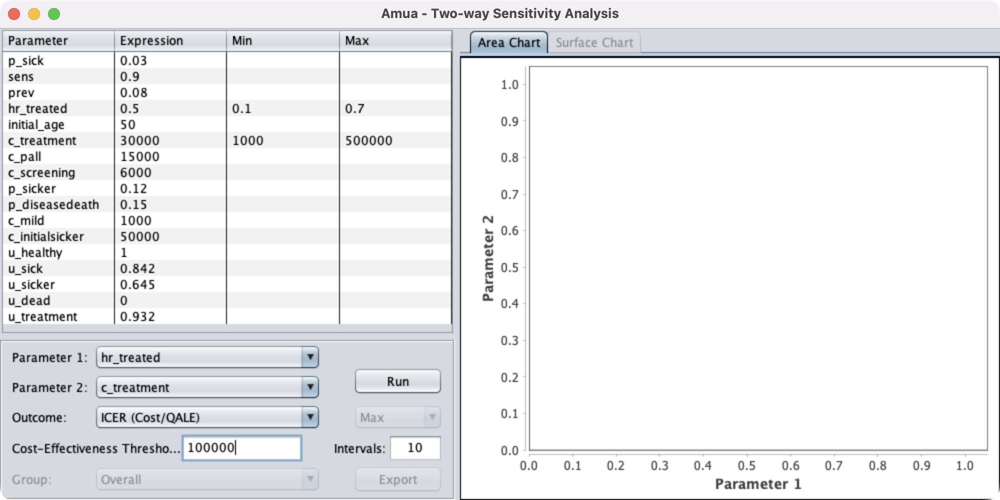

## B: Run The Analysis

1.  Click "Run"
2.  Click "Update Plot"

The plot should now display a matrix grid with a decision for each value
intersection as well as a mark for the base values.

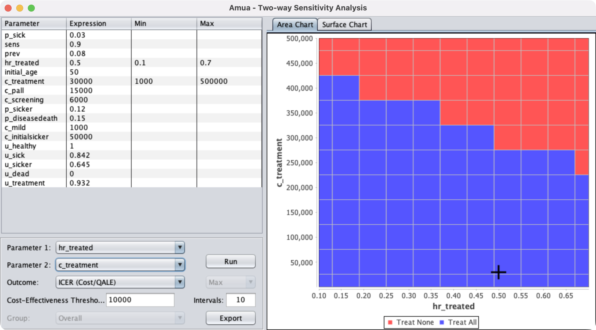

## C: Check The Plot

1.  Verify that the plot makes sense
    - Look at the four corners and make sure the decision is clinically
      realistic
      - Parameter 1 high, Parameter 2 low

      - Parameter 1 high, Parameter 2 high

      - Parameter 1 low, Parameter 2 high

      - Parameter 1 low, Parameter 2 low

## D: Common Issues

- If your strategy is dominated or dominant, ICERs will not show and
  therefore no graph will be created.

  - However, in the benefits lecture we talked about the alternatives
    (NMB or NHB). You can get this by setting the analysis type to
    "Benefit-Cost Analysis (BCA)" in Model \> Properties \> Analysis

    - <https://github.com/zward/Amua/wiki/Model-Properties#analysis-type>

::: {.callout .fill-box .task-box}
## Your Task

Understand the uncertainty in the model when all parameters are adjusted
:::

# Step 6: Run a PSA

## A: Determine variable distributions

The table below provides recommendations:

| Parameter Type                  | Distribution     |
|---------------------------------|------------------|
| Probability                     | beta             |
| Rate                            | gamma            |
| Utility weight                  | beta             |
| Right skew (e.g., cost)         | gamma, lognormal |
| Relative risks or hazard ratios | lognormal        |
| Odds Ratio                      | logistic         |

For each variable you will need to determine the necessary Amua inputs.

### Formulas to use distributions in Amua:

Pulled from: [Link to Amua Input
Documentation](https://github.com/zward/Amua/wiki/Distributions){target="_blank"}

+--------------+------------+---------------+-------------+-------------+
| Distribution | Name       | Description   | Parameters  | Support     |
+==============+============+===============+=============+=============+
| `Beta`       | Beta       | A continuous  | `a`: Shape  | Real        |
|              |            | distribution  | parameter   | numbers in  |
|              |            | bounded by    | `>0`\       | `[0,1]`     |
|              |            | `0` and `1`.  | `b`: Shape  |             |
|              |            | Often used to | parameter   |             |
|              |            | model         | `>0`        |             |
|              |            | probabilities |             |             |
+--------------+------------+---------------+-------------+-------------+
| `Gamma`      | Gamma      | A continuous  | `k`: Shape  | Real        |
|              |            | distribution  | `>0`\       | numbers     |
|              |            | that yields   | `θ`: Scale  | `>0`        |
|              |            | positive real | `>0`        |             |
|              |            | numbers       |             |             |
+--------------+------------+---------------+-------------+-------------+
| `Logistic`   | Logistic   | A continuous  | `μ`:        | Real        |
|              |            | distribution  | Location\   | numbers     |
|              |            | that          | `s`: Scale  |             |
|              |            | resembles the | `>0`        |             |
|              |            | Normal        |             |             |
|              |            | distribution  |             |             |
|              |            | in shape but  |             |             |
|              |            | has heavier   |             |             |
|              |            | tails         |             |             |
+--------------+------------+---------------+-------------+-------------+
| `LogNorm`    | Log-Normal | A continuous  | `μ`:        | Real        |
|              |            | distribution  | Location\   | numbers     |
|              |            | of a random   | `σ`: Scale  | `>0`        |
|              |            | variable      | `>0`        |             |
|              |            | whose         |             |             |
|              |            | logarithm     |             |             |
|              |            | follows a     |             |             |
|              |            | Normal        |             |             |
|              |            | distribution  |             |             |
+--------------+------------+---------------+-------------+-------------+

If you need help getting the distribution values, use the following
tool: [Distribution
Solver](https://yuhanxuan.shinyapps.io/shiny4dist/){target="_blank"}

## B: Save a Model Copy

We recommend that you create a copy of your model to use for PSA as you
will override your variables.

1.  Save your model (Model \> Save)

2.  Then use Model \> Save As to create a duplicate (Example:
    model_psa.amua)

## C: Update the Variables

1.  Start with the `p_sick` variable. It is a beta distribution with
    `alpha = 4.3996` and `beta = 127.3367`

2.  Double click on `p_sick` to open the "Define Parameter" pop-up

    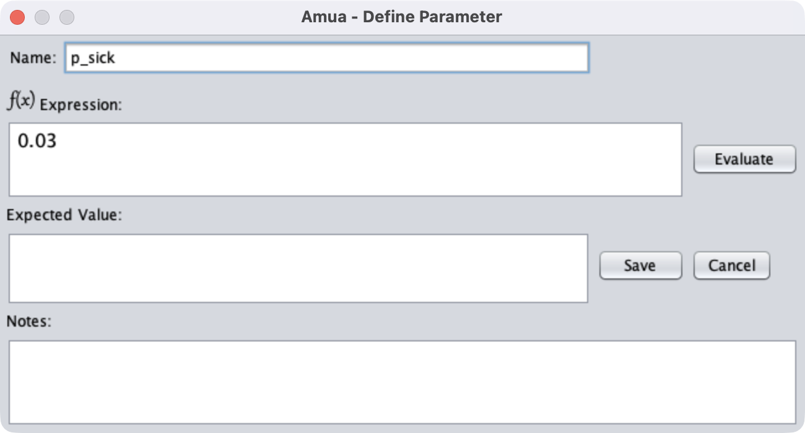{width="500"}

3.  Delete all the previous expression

4.  Click the 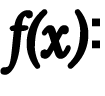{width="25"}
    before "Expression" to open the "Build Expression" pop-up

5.  Under "Elements" select Distribution \> Beta

    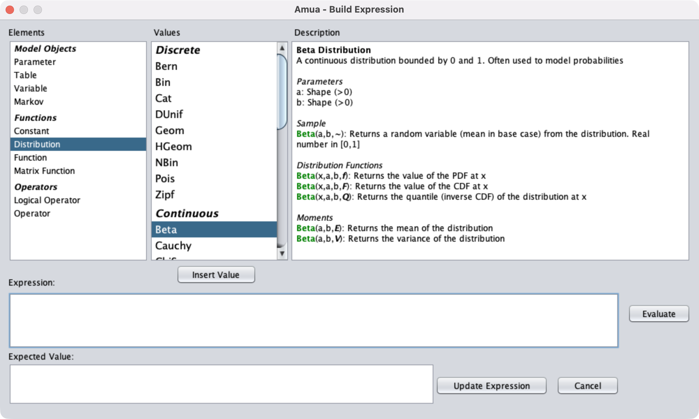

6.  Click `Insert Value`

7.  Replace `a` with `4.3996` and `b` with `127.3367`

    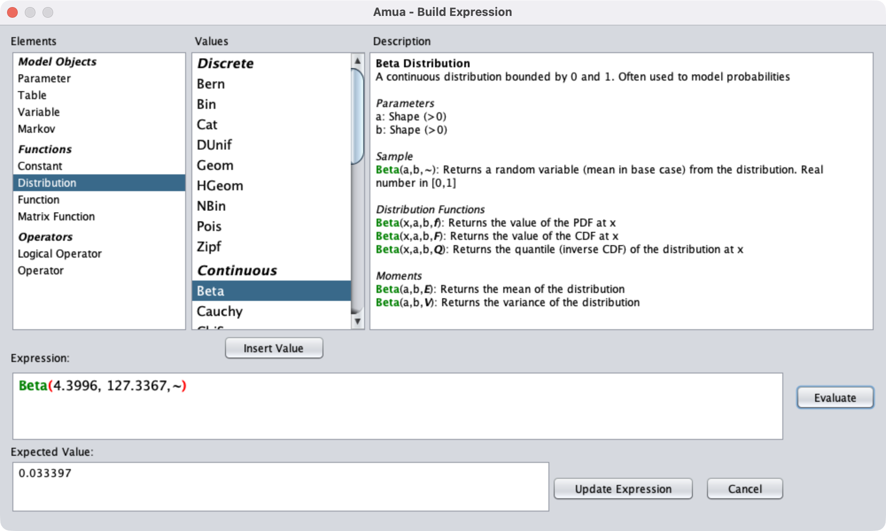

8.  Click `Update Expression`

9.  Repeat for all the following variables

### Beta

| Variable       | Alpha (a) | Beta (b) |
|----------------|-----------|----------|
| p_sick         | 4.3996    | 127.3367 |
| p_sicker       | 7.7719    | 36.3478  |
| p_diseasedeath | 2.5561    | 20.8677  |
| sens           | 256.2902  | 29.2273  |
| prev           | 74.3729   | 855.2879 |
| u_sick         | 342.9965  | 62.1399  |
| u_sicker       | 226.2892  | 121.4084 |
| u_treatment    | 2313.2903 | 173.2424 |

### Gamma

| Variable        | Shape (k) | Scale (θ) |
|-----------------|-----------|-----------|
| c_treatment     | 5.9944    | 10000     |
| c_pall          | 6.4077    | 2000      |
| c_mild          | 8.4748    | 133.333   |
| c_initialsicker | 75.7058   | 714.286   |

### lognorm

| Variable   | Location (μ) | Scale (σ) |
|------------|--------------|-----------|
| hr_treated | -1.3296      | 0.4964    |

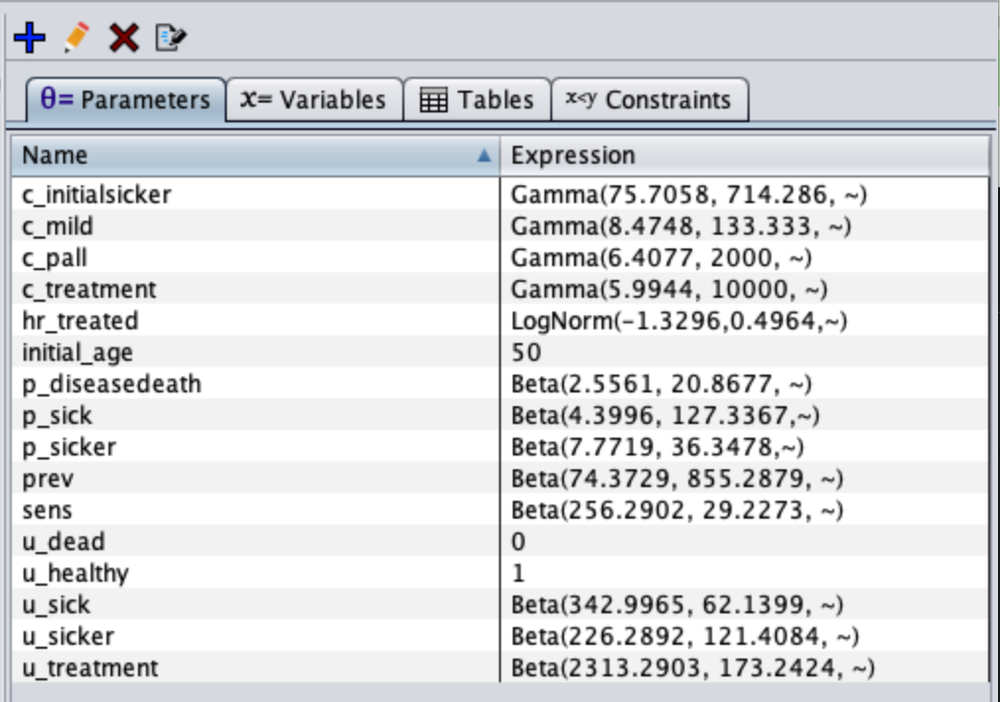

## D: Setup the Run

1.  Go to Run \> Sensitivity Analysis \> Probabilistic (PSA)


2.  Verify that all the parameters look correct

## E: Run The Analysis

1.  Set the "\# Iterations"
2.  Click "Run"

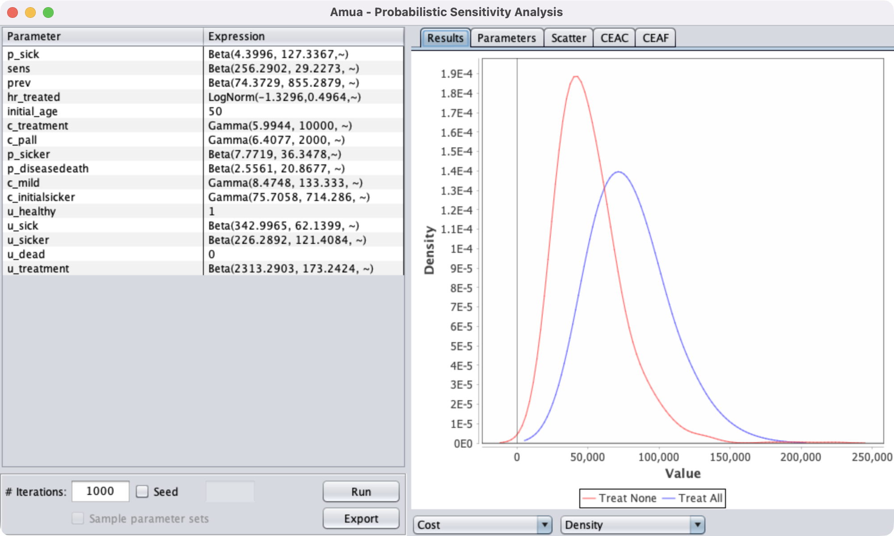

## F: The Plots

This will create 4 tabs of graphics. To understand these, use the Amua
guide [Link to Amua Input
Documentation](https://github.com/zward/Amua/wiki/Sensitivity-Analysis#probabilistic){target="_blank"}

CEAC is most commonly presented in results.

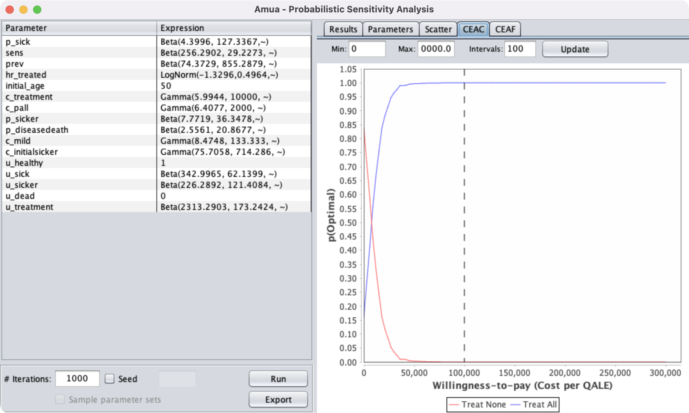
